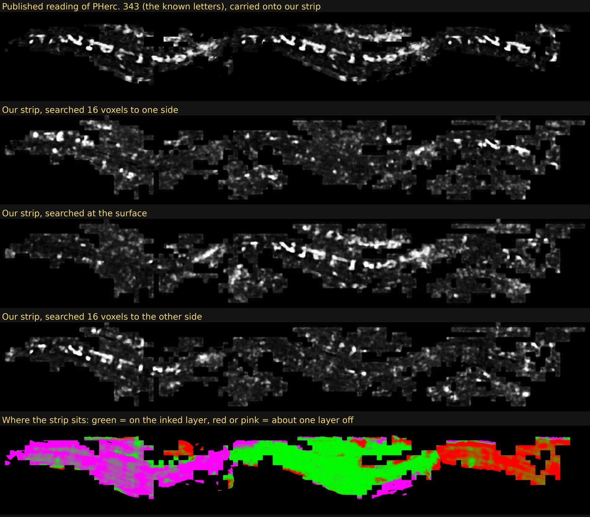
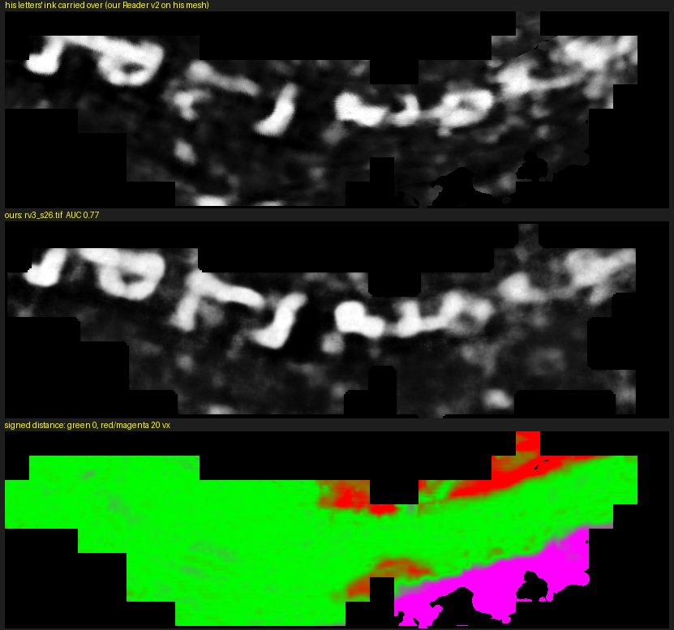
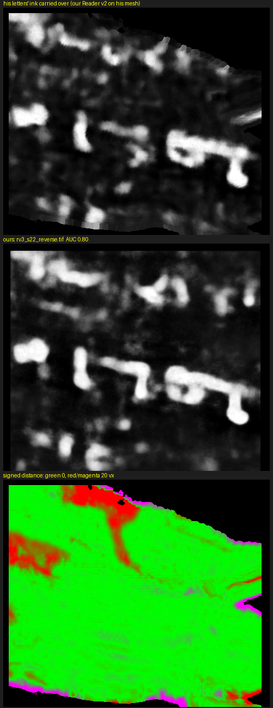
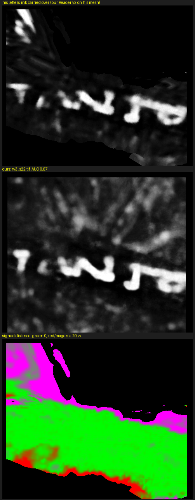
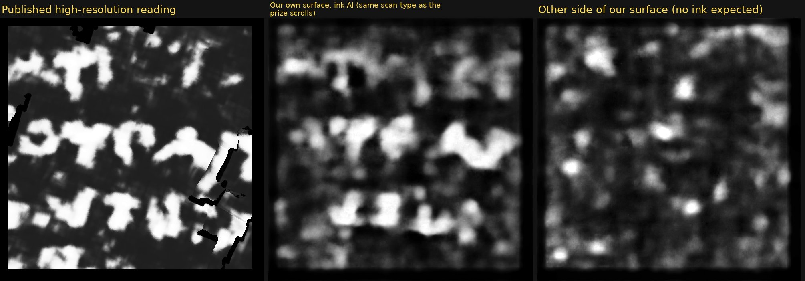
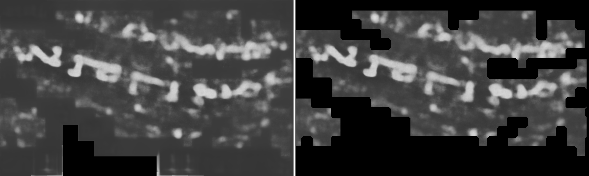

# Validation on public data

DRAFT 2026-10-21 — the scores, sizes and counts below were re-checked against the result files (score files of the
control runs, the rented run's check maps) on 2026-10-21; run times and speeds are from the content lead's run log. Only public, already-read scrolls appear here.

A search kit is only useful if it would see writing where writing is. We checked that on two
public scrolls whose text is already known, then checked that a rented machine reproduces the
results of a desktop machine.

## 1. PHerc. 0343 (8.64 µm): known letters, recovered on our own stitched strip

PHerc. 0343's first letters were found and published by Erwin Nieuwlaar (First Letters prize,
October 2026). We grew our own surfaces around his letter area with the kit's recipe (12 seeds,
200 expansions, 48 generations, `snap_weight` 1), stitched them into one strip (`same_surface_th` 4: 38,860 nodes,
11.6 cm² by the kit's measure of nodes × 20² voxels, a 1.9 × 12.3 cm strip), rendered 61 layers and read them with
Reader v2 and Reader V3 at 11 depths (on the content lead's run log: stitching 61 s, render 40 s, Reader v2 ~9 min on
an RTX 4070 SUPER).

Our strip is not everywhere on the inked layer: like any automatic surface, parts of it sit some voxels inside it
(toward the scroll axis) or outside it. We carried Reader v2's map of his own surface, where the letters were found,
onto our strip (`score_deep.py`, tolerance 40 voxels) and correlated it with our maps, by how far our surface sits
from his inked layer. Depths count inward: + looks toward the axis.

| our surface vs. his inked layer | Reader v2: best r (depth) | Reader V3: best r (depth) |
|---|---|---|
| 14-40 voxels inside | 0.73 (−20, −16) | 0.78 (−20) |
| 4-14 inside | 0.63 (−12) | 0.70 (−12) |
| within ±4 | 0.89 (0) | 0.88 (0) |
| 4-14 outside | 0.84 (+12) | 0.85 (+12, +16) |
| 14-40 outside | 0.77 (+20) | 0.79 (+20) |

Each part of the strip shows the letters at its own depth, on the side where the inked layer lies: parts outside it
at inward depths, parts inside it at outward ones. Reading only at depth 0 would have missed most of them; that is why
the kit reads 11 depths. Scored against his 18 letter boxes instead (a coarser reference), the pattern is the same at
lower r: 0.43 (v2) and 0.45 (V3) within ±4 voxels. These directions hold for this strip; on other surfaces the
renderer's normal can point the other way, which is why the kit works out each strip's reading side
(`reading_side.py`).

*Top: the published reading of PHerc. 0343 carried onto our strip. Then our Reader v2 maps 16 voxels to one side, at
the surface and 16 voxels to the other side, and where the strip sits relative to the inked layer. PHerc. 343
letters first found by Erwin Nieuwlaar (First Letters, 2026).*

The quick configuration (`kit/config/control-0343-quick.env`) seeds six of the known letters (`SEEDS_EXTRA`,
positions from Erwin Nieuwlaar's letter boxes) and starts strips there, so a whole run, from seed to ink map, can be
checked against them. In a release-candidate run on one desktop RTX 4070 SUPER (75 minutes from setup to the last map),
the strip started at letter 6 grew to 1.55 cm² and reached 10 of the 18 letters. The eight it covers on his layer (5-12)
show in the run's own Reader V3 map; letter 13 has too few samples on his layer and letter 18 lies off it. Where the
strip lies within ±4 voxels of his layer, the map separates the inside of his letter boxes from the gaps around them
with an AUC of 0.77 at depth +4 (0.5 would be chance; inside/gap contrast 1.3-1.9 for letters 5-12), against 0.75 for
the strip above at the same depth.

*Top: Erwin Nieuwlaar's letter layer (his mesh and letter boxes) read with Reader v2. Middle: the kit's own Reader V3
map at depth +4 (`rv3_s26.tif`) on the strip the quick configuration grew from letter 6. Bottom: the distance between
the two surfaces along his normal: green 0, red up to 20 voxels inside his layer, magenta up to 20 voxels outside.
Letters first found by Erwin Nieuwlaar (First Letters, 2026); Reader v2 and V3 by Domenico Russo; scan: PHerc. 0343,
Vesuvius Challenge open data. Image CC BY-NC 4.0.*

The stitcher started at the other five letters stopped almost at once (0.05-0.90 cm²), so the kit now inks the patch
grown at any seed point that no strip reaches ([LESSONS](LESSONS.md) §18). In a second release-candidate run with that
fallback (76 minutes), all six strips started at letters stopped below the 1 cm² a strip must have, and the six patches
grown at the letter points (2.64 cm² each) were inked as they are. Together they reach all 18 letters, and each of them
shows: where a patch lies within 4 voxels of his layer, at depth 0 or +4, every letter is brighter than the gaps around
it in at least one patch (AUC 0.67-0.97 per letter; the strip above, measured the same way: 0.62-0.97). Each patch's
best AUC over all the letters it reaches is 0.67-0.84, against 0.75 for the strip above. Two of the patches show the
same letterforms as his layer:

*The patches the kit grew at letter 6 (left) and letter 4 (right), each inked as it is. Top: Erwin Nieuwlaar's letter
layer (his mesh) read with Reader v2. Middle: the kit's own Reader V3 map at depth 0 (`rv3_s22_reverse.tif` and
`rv3_s22.tif`: the two patches face opposite ways, and the kit chose each one's reading side from the scroll's axis).
The right one's lower AUC is that of letters 1-5, the faintest of the 18 for Reader V3: the strip above scores the same
on them (0.67). Bottom: the distance between the two surfaces along his normal: green 0, red up to 20 voxels inside
his layer, magenta up to 20 voxels outside. Letters first found by Erwin Nieuwlaar (First Letters, 2026); Reader v2 and
V3 by Domenico Russo; scan: PHerc. 0343, Vesuvius Challenge open data. Image CC BY-NC 4.0.*

All of these surfaces were started at letter positions the run was given. They check the whole chain on the kit's own
geometry (scan, surface, rendering, ink map) where writing is known to be; they do not show that the kit finds writing
unaided: no strip started by the kit's own rule reached the part of his layer that holds the letters in either run (the
nearest stayed 66 voxels away).

## 2. PHerc. 0814 (9.362 µm, the scan type of the eligible scrolls): known text lines

The eligible scrolls were scanned at 9.362 µm / 1.2 m / 113 keV, a harder scan type than
PHerc. 0343's. PHerc. 0814 has a published team segment and reading on the same scan type. We
put 12 seeds on that segment's text band and grew our own small patches (1.3 cm² each). They
lie on the team's inked layer for 43-92 % of their area (median 79 %). Where they do (the ±4-voxel
band around the team's surface, 40,000-86,000 samples per patch), Reader v2 at depth 0 on our patches matches the
team's 2.4 µm ink result with r = 0.65, 0.63, 0.53, 0.52 and 0.46 for the best five patches (written side), and
−0.16 to +0.01 on the other side of the sheet; the other seven patches reach 0.23-0.37 (scores re-read from the run's
`score.tsv` files, 2026-10-20). By eye, the best patch shows the same three rows of letters as the published reading.

*Left: the team's published high-resolution reading of the PHerc. 0814 segment. Middle: Reader v2 on our own patch
of the same place, on the 9.362 µm scan type of the eligible scrolls. Right: the other side of our surface, where no
ink is expected. PHerc. 0814 segment and reading: Vesuvius Challenge open data (CC-BY-NC 4.0).*

So on the eligible scan type, this pipeline sees writing where its surface is on the inked layer.
A blank result therefore means one of two things: no writing there, or the surface was not on the
inked layer. The kit cannot tell those apart by itself.

## 3. Same answer on a rented machine

Before the rented run, the kit re-rendered and re-inked a strip that had already been searched on
the desktop machine (RTX 4070 SUPER). On the rented machine (8 × RTX 4070 Ti SUPER, same Ada
architecture) all 11 maps were byte-identical. The published kit repeats this check on a
PHerc. 0343 control strip (`kit/work/check.sh`), with the run's own ink model and batch size, against reference maps
made by that model (Reader V3 and Reader v2 are included), and reports r per map; on other GPU architectures expect
r > 0.99 rather than identical bytes (not yet tested).

## 4. Reader V3 against Reader v2 on PHerc. 0343

Scored on the same PHerc. 0343 strip against Erwin Nieuwlaar's 18 letter boxes, which neither model produced: how
well each map separates letters from the gaps between them (AUC, 0.5 = chance).

| depth window | Reader v2 | Reader V3 |
|---|---|---|
| on the inked layer | 0.725 | 0.746 |
| one layer off (each side) | 0.616 / 0.616 | 0.661 / 0.648 |

On the same desktop GPU, Reader V3 read 33-37 s per cm² per direction against Reader v2's 42. Two differences matter
for a search. V3 draws faint lines and a regular comb of strokes where its input is empty: outside the mesh, or where
the surface leaves the scan's mask. Those look like writing, so the kit sets every map to 0 wherever its input layers
are all 0 (`nodata.py`; `nodata_<prefix>.tsv` per strip says how much it removed). Measured on the control strip,
whose rendered rectangle is 46 % empty: Reader V3 wrote non-zero values over 89 % of the empty area, up to 0.89 on the
0-1 scale; Reader v2 over 46 % of it, a flat ~0.24 inside inference tiles that also held data, up to 0.73. Valid
pixels next to the empty areas are not raised by either model (V3 averages 74/255 within 2 pixels of an empty area
and 96 deep inside it; v2 78 and 92), so the kit zeroes exactly the empty pixels (`NODATA_MARGIN=0`). Valid pixels
come out byte-identical.

*Reader V3 on the PHerc. 0343 control strip, depth window 22-38, before (left) and after (right) `nodata.py`. The grey
fill and the comb of short vertical strokes along the bottom edge lie where the strip has no data; the letters are
untouched. PHerc. 343 letters first found by Erwin Nieuwlaar (First Letters, 2026).* And V3 is "hotter": at p > 0.5 it
marks about twice as many pixels as v2, so a fixed threshold means different things for the two models. The kit
itself uses none (blank strips are found from the render, the same-answer check uses correlation).

## What this does not show

- That writing exists anywhere in particular, or that the kit will find it. On a scroll where the
  surface prediction merges sheets, automatic surfaces often cut across layers and read nothing. In the quick runs of
  §1, the letters came from surfaces started at given letter positions, not from the kit's own strip starts.
- That the maps can be triaged automatically. Reviewing thousands of maps is still a human job;
  we found no automatic score that ranks known writing above the blob fields and crack edges that
  fire on blank papyrus.
